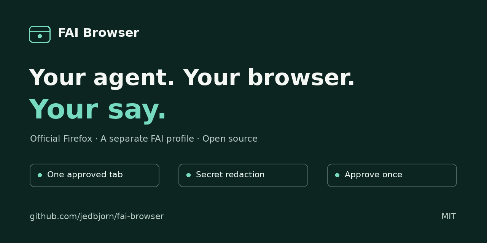
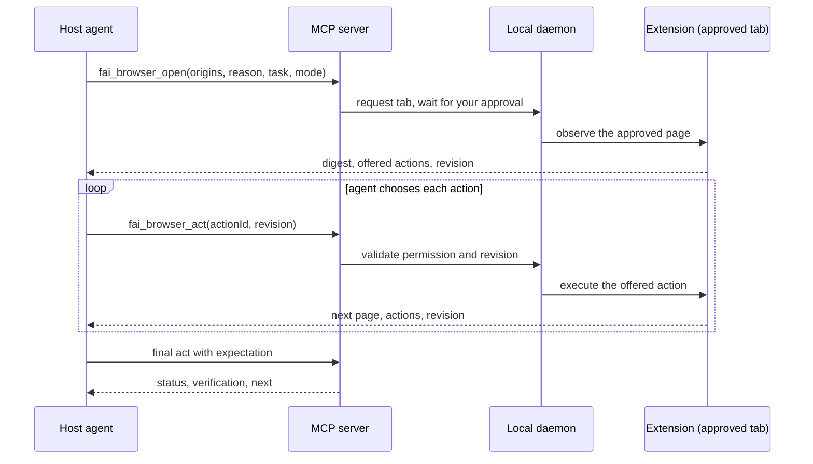

# FAI Browser

**Give your coding agent one browser tab you approve, with compact page summaries,
action approvals and verified outcomes.**

[](https://github.com/jedbjorn/fai-browser/actions/workflows/ci.yml)
[](https://github.com/jedbjorn/fai-browser/releases)
[](LICENSE)
[](package.json)
[](package.json)
<br>
[](docs/REFERENCE.md#coding-agents-mcp-and-skill)
[](docs/guide/install.md)
[](#contributing)
<br>
[](https://glama.ai/mcp/servers/jedbjorn/fai-browser)

[Website](https://fai-browser.designs-os.com/) · [Install](docs/guide/install.md) · [Measured comparisons](#benchmarks)

FAI Browser lets a coding agent work in one Firefox tab you approved, in your own signed-in browser.
**Your agent drives**: `fai_browser_open` asks for your approval and returns a compact
page digest with the actions your granted level allows; your agent picks one with `fai_browser_act`
and gets the next page back, until an expectation verifies the outcome. No key, no provider calls,
and every action passes the same guardrails: levels, origins, forbidden labels, and explicit
approval for payments. Login is restricted to your configured test environments.

## Why

- **Your agent drives.** Each result contains a compact page digest and allowed actions. The agent
  chooses the next action and checks the outcome against an expectation.
- **Less page text per turn.** On twelve captured public pages replayed locally, opening results
  used a median 1,147 tokens versus 11,787 for full accessibility snapshots (rounded, o200k_base).
  This measures output size, not task success; see the [method and results](bench/tokens/results-real-0.3.1.md).
- **You stay in control.** The agent gets one task tab by default, only after you approve its request: the page opens in
  a new tab in the existing browser window by itself. Click **Approve** in its request modal, allowing browser site
  access when asked, or click the FAI Browser toolbar icon on that tab (a request for `full` or
  `testing` shows the FAI Browser window first, where you pick the level and **Open** the page).
  You can pause or stop at any time. Screenshots on either browser may still need the toolbar click;
  modal approval requests host access, which does not itself grant screenshot access.
- **Results are receipts, not guesses.** `completed` means an independent expectation passed. Each
  result carries a trusted `verdict` and `next {kind, text}`: answer, choose, observe, relay to the
  user, approve or stop.
- **Invite an agent to a tab you are on.** The toolbar popup's **Invite an agent to this tab** hands the current
  tab to a live Claude Code, Codex or OpenCode session at the level you pick. Approve and Resume wake that session,
  so it continues without you typing "done" (other hosts get a copy-paste line).
- **Several browsers, one service.** Several Firefox installs (the FAI profile and your own Firefox, say) can be paired
  at the same time; each holds its own task tab, and a request opens in the browser you used last (or the one the agent names).
- **Frames you approved are readable.** A cross-origin frame inside the page (an admin portal's content blade, say) is
  read and acted on when its own origin is one you approved; other frames are never read and are boxed in screenshots.
- **Everything is local.** The FAI service, extension and traces stay on your machine, outside the
  checkout; FAI makes no model or provider calls.

## Demo

[](https://fai-browser.designs-os.com/#demo)

[Watch the demo](https://fai-browser.designs-os.com/#demo) · [Download MP4](docs/media/demo.mp4) · [30-second cut](docs/media/demo-social.mp4)

Real Firefox development-build UI on local test sites, with scripted clicks and edited presentation.
The demo shows payment approval, verified confirmation, secret redaction, and approved secret reuse.
[Capture provenance](docs/guide/demo.md).

## Benchmarks

Two measurements answer different questions: how much page text reaches the agent, and how
**Agent direct** (your agent driving) completes a workflow compared with Playwright MCP. All figures are local fixture runs with their limits stated next
to the numbers.

### Page output size

Twelve captured public pages, replayed locally with 0.3.1. Median opening output with `o200k_base`:

| | FAI Agent direct | Full accessibility snapshot |
|---|---:|---:|
| Observed text tokens | **1,147** | **11,787** |

**90.3% fewer tokens** in the ratio of corpus medians (snapshot median rounded from 11,786.5).
This compares full Playwright-style accessibility snapshots with FAI opening results. It measures
output size, not task success or billed model usage. Current Playwright MCP may return snapshot-file
references; the task benchmark below includes the contents actually read.
[Method, per-page data and limits](bench/tokens/results-real-0.3.1.md).

### Model-driven task comparison

Measured 2026-11-06 on local fixtures, two repeats per task. Values are per-task averages of
per-task medians. Wall time is host spawn to exit. Host tokens are full vendor usage; cost is
host-only pricing from `bench/prices.json`, not a subscription invoice. Lower time, token and cost
are better; higher pass counts are better. Text workflows ran on Sol 6.1 medium, visual workflows on
Claude Sonnet 5.5 medium.

| Workflow set | Metric | Playwright MCP | FAI Agent direct |
|---|---|---:|---:|
| Sol 6.1, 6 text tasks | Task checks passed | 12/12 | 12/12 |
| | Wall time | 27.1 s | 42.3 s |
| | Raw host tokens | 109.7k | 227.2k |
| | Host-only cost | $0.0419 | $0.0788 |
| Claude Sonnet 5.5, 2 visual tasks | Task checks passed | 4/4 | 4/4 |
| | Wall time | 29.8 s | 20.0 s |
| | Raw host tokens | 115.9k | 104.9k |
| | Host-only cost | $0.0542 | $0.0604 |

Two safety scenarios are excluded from performance figures; all runs had zero safety flags.
Sources: Agent-direct [text](bench/results/site-agentdirect-optimized-2026-11-06/summary.json) and
[visual](bench/results/site-agentdirect-optimized-visual-2026-11-06/summary.json) summaries.

The earlier native-relay pass (`bench/showcase/results-native-2026-11-06.md`) reports the
same four workflows with protocol-level detail (MCP calls, snapshot-file reads, observed
text tokens) plus the two safety scenarios; it makes no speed or cost claim. The separate
live Amazon/eBay search probe returned HTTP 503/403 and claims nothing.
[Probe results](bench/showcase/results-live-search-2026-11-06.json).

## How it works



The daemon on `127.0.0.1:4318` owns tab requests, leases, acts, traces and the pairing secret; the
extension acts only in the approved tab. See [ARCHITECTURE.md](ARCHITECTURE.md).

## Quickstart

Requires Node 22+ and Firefox 140+, on Linux or macOS. On **Windows**, one command sets up everything: see
[Windows](#windows). FAI Browser is Firefox only: Chrome, Brave, Edge and the other Chromium browsers are not supported from v0.12.0 ([Browsers](#browsers)).

**Try it without a key or browser:**

```sh
npm test
node examples/fake-demo.js   # in-memory bridge; observe, then act; prints a result
```

**Set it up for real (one time):**

```sh
git clone https://github.com/jedbjorn/fai-browser.git
cd fai-browser
npm run setup
```

**macOS without git or Node yet?** The installer checks for git and Node 22+, installs a missing one only after you say
yes (Apple's Command Line Tools for git; Homebrew if you have it, else the official nodejs.org package checked against
its SHA-256), clones the latest release into `~/fai-browser` and runs setup. Download it from a release tag, read it,
then run it ([details](docs/REFERENCE.md#bootstrap-installers)):

```sh
curl -fsSLo install-fai.sh https://raw.githubusercontent.com/jedbjorn/fai-browser/<tag>/scripts/install.sh
less install-fai.sh && sh install-fai.sh
```

`<tag>` is the newest release on the [Releases page](https://github.com/jedbjorn/fai-browser/releases) that has
`scripts/install.sh` (v0.9.0 or newer). `--check` only reports what is there and what it would do. On
Linux it installs no git or Node (it prints the package command); with both present it clones and runs setup there too.
Those git and Node install steps (the Command Line Tools dialog, `brew install node`, the `.pkg`) have not been
exercised in CI yet: the CI runners already have both.

1. `npm run setup` saves its settings in `~/.config/fai-browser` (macOS: `~/Library/Application
   Support/fai-browser`), installs browser pairing for every browser it finds, starts the FAI service and asks
   whether to register FAI Browser with each coding agent on your `PATH` (Claude Code, Codex, OpenCode).
2. Pick a browser ([install guide](docs/guide/install.md)):
   - **Firefox, dedicated FAI profile (recommended):** accept setup's last prompt, or run `node src/cli.js launch`.
     It starts Mozilla's unmodified Firefox with a separate profile and the signed add-on, already paired.
   - **Your existing Firefox:** install the signed `fai-browser-firefox-<version>.xpi` from
     [GitHub Releases](https://github.com/jedbjorn/fai-browser/releases).

   The extension pairs by itself: nothing to copy or paste.
3. Pin the FAI Browser icon (puzzle-piece menu, then the pin) for controls, invites and toolbar approval. You can
   also approve directly in the request modal.
4. Restart your coding agent.

To register an agent later: `node src/cli.js install --host claude|codex|opencode`.

### Windows

Firefox only, as on every system. In PowerShell:

```powershell
irm https://raw.githubusercontent.com/jedbjorn/fai-browser/main/scripts/install.ps1 | iex
```

That is the whole setup. Per user, without administrator rights or Developer mode, it installs a private Node.js
(checked against nodejs.org's checksums; a Node you already have is left alone) and the latest FAI Browser release under
`%LOCALAPPDATA%\fai-browser`, then runs setup: the pairing secret, Firefox's pairing helper, the FAI service,
registration with Claude Code, Codex and OpenCode (including detected desktop apps), and FAI Browser itself: your official
Firefox, or Mozilla's downloaded into FAI's folder when you have none, with a separate FAI profile and the signed add-on,
already paired. It adds a **FAI Browser** Start menu entry and the `fai-browser` command.

1. When it says **FAI Browser is installed**, a Firefox window titled *FAI Browser is ready* is open.
2. Restart your coding agent, then ask it to work in your browser. Its requests open in that window; you approve each.
3. Later: open FAI Browser from the Start menu (it starts the FAI service by itself).

Setup's closing line names the apps registered and asks you to restart them. Claude's **Code tab**, Codex in the
ChatGPT app, and OpenCode Desktop 1.19 to 1.x use the same wake channels as their CLIs; ordinary Claude and ChatGPT
chat are excluded. Codex wakes need the standalone Codex CLI (`npm install -g @openai/codex`), even for the app, and a
first FAI call to name the thread. Existing OpenCode `opencode.jsonc` needs the printed manual config/plugin step;
setup preserves it and says OpenCode was not auto-registered. The popup's fixed wake-reason sentence explains missing
steps; the copy line remains available. [Per-app support and limits](docs/REFERENCE.md#invites-and-wakes).

Windows channel tests are enabled. On Windows 10, live wakes passed for Claude's Code tab, Codex in the ChatGPT app
and the OpenCode CLI 1.19.5; OpenCode Desktop's live wake is unverified, and Windows 11 is not yet checked.

Run the same command again to update. Remove everything with
`powershell -ExecutionPolicy Bypass -File "$env:LOCALAPPDATA\fai-browser\uninstall.ps1"`. Coding agents can follow
these steps for you: the command needs no input. Details: [install guide](docs/guide/install.md#windows).

**Updating.** About once a day FAI checks GitHub for a newer tagged release and the popup then shows **Update
available vX.Y.Z**. One click on **Update** (or `node src/cli.js update`) moves this clone to the release tag, refreshes
pairing and the installed skill, restarts the FAI service and reloads the extension; nothing installs without it.
It refuses while an agent holds a tab and never touches local changes. The signed Firefox add-on updates itself.
See [Updates](docs/REFERENCE.md#updates).

**Invites and wakes.** On any normal web tab, the popup's **Invite an agent to this tab** binds that tab, at the level
you choose, to a live coding-agent session and wakes it with a single-use invite id (`inv-…`, 10 minutes); the agent
calls `fai_browser_open {"inviteId": "inv-…"}`. When FAI can wake the session (Claude Code's messaging socket, Codex's
`codex queue`, OpenCode through the small FAI plugin `install --host opencode` adds), your Approve or Resume click
continues the agent's turn; otherwise the popup shows a line to paste into the chat. See
[Invites and wakes](docs/REFERENCE.md#invites-and-wakes).

With your agent driving, `fai_browser_open` requests approval and returns the first page: digest,
offered actions and a single-use revision. Your agent answers from the digest or calls
`fai_browser_act` with an action id and that revision; each act returns the next page and actions.
A filled search field offers "press Enter"; a deep URL in `allowedUrls` opens directly on approval;
screenshots are on request only. An expectation on the final act verifies the outcome. See
[Your agent driving](docs/REFERENCE.md#agent-direct).

**From the shell** (the same loop, one JSON line per command):

```sh
node src/cli.js request-tab --origin https://app.example.com --reason "Check the members list"
node src/cli.js observe --request <requestId>
node src/cli.js act --request <requestId> --action a3 --revision <revision> --expect-url-includes /members
```

Approve with **Use** to let the agent read and navigate in one task tab, or **Act** to allow actions and up to eight task tabs on approved sites. Each button approves directly; there is no level dropdown or separate tab setting. Act requests browser site access where needed. Task tabs share the task group where supported; personal tabs stay outside the task. A page-created tab pauses a Use task.

**Or from your agent, through MCP:**

```json
{
  "name": "fai_browser_open",
  "arguments": {
    "origins": ["https://app.example.com"],
    "reason": "Check the members list",
    "task": "How many members are listed?"
  }
}
```

Every result carries a trusted `next {kind, text}` the host follows literally. The MCP server's instructions cover the loop on their
own; the [skill](skills/fai-browser/SKILL.md) installed by `install --host` teaches the full loop;
[docs/REFERENCE.md](docs/REFERENCE.md#output-status-and-exit-codes) documents every field, status
and exit code.

## Safety model

- **Task tabs, approved by you.** Each request names exact origins (or, for a task across
  subdomains, a domain root shown as "all of example.com", which the browser also asks you to allow)
  and a reason. Existing personal tabs are shared only when you invite the agent.
- **Two approval buttons.** **Use** permits reading, links, navigation, scrolling and waiting in one task tab.
  **Act** permits actions, including save, send, submit, delete and accept cookies, and up to eight task tabs
  on approved sites. Both buttons approve directly. Your explicit click sets the grant; existing grants
  are never silently raised. Legacy API modes remain supported as limits on individual calls.
  The receipt’s `permissions` block reports what was requested, granted and effective.
  At Act, a Send, Submit, Save or Delete click does not ask again; see [Guardrails by level](docs/guide/safety-model.md#guardrails-by-level).
- **Payments require your approval.** With the agent driving and the Approve gate enabled,
  a payment action waits for your **Approve once** click. With the gate off, purchases are refused
  outside testing mode. Sign-in pages are handed
  back to you; agents may enter credentials only in your configured test environments.
- **Testing mode is for your test environments only.** It permits sign-in and checkout and can
  only be explicitly enabled with **Act** for testing requests on origins you listed under Advanced, Test sites
  (`http://localhost:3000`, exact origins, no wildcards). Secret-handle use still requires approval;
  filling a saved secret handle into password fields on sign-in forms is currently unsupported.
- **Cookies and newsletters:** New Use and Act approvals include necessary-only cookies and newsletter dismissal. FAI selects a clear reject/necessary-only button or closes an unsolicited newsletter modal, using the same paced clicks and visibility checks as links. Ambiguous choices go to the agent; Use grants no general button access. Accepting optional cookies still requires effective mode `full`. Sign-in controls and password fills are never offered below Test site.
- **Guardrails you can tighten at any level.** `policy: {"forbid": [...], "note": "..."}` per run or
  in `config.json` adds refused labels, testing included; nothing removes one.
- **Page text is untrusted.** Receipts separate trusted fields from page text; an injection guard
  limits what runs on pages that address an agent.
- **Local service and traces.** FAI makes no model or provider calls of its own. Secrets are
  redacted from everything returned to the agent; traces are pruned
  (50 runs, 500 MB, 7 days). Besides the daily update check, an anonymous GET to GitHub's releases
  API (with a `git ls-remote` fallback on your clone's remote if the API does not answer for the
  repository; `FAI_UPDATE_CHECK=0` turns it off), FAI only contacts GitHub and Mozilla to download
  Firefox, the add-on or an update you asked for.

Details: [Policies](docs/REFERENCE.md#policies),
[Guardrails](docs/REFERENCE.md#guardrails) and [Traces and
retention](docs/REFERENCE.md#traces-and-retention).

## Works with

| | |
|---|---|
| **Coding agents** | Claude Code, Codex CLI and OpenCode via `node src/cli.js install --host claude\|codex\|opencode`, with invites and wakes for all three; any other MCP client through the stdio server `fai-browser-mcp` (no wakes) |
| **Without MCP** | the CLI (`node src/cli.js`, one JSON line per command) and the SDK client (`FaiBrowserClient`) |
| **Browser** | Firefox 140+ (the signed add-on); several installs can be paired at once; pairing by native messaging. Chromium browsers are not supported from v0.12.0. See [Browsers](#browsers) |

### Browsers

| Browser | Status | Load | Tested |
|---|---|---|---|
| Firefox 140+ | Supported, with the gaps below | `node src/cli.js launch` (dedicated profile), or the signed `.xpi` from [Releases](https://github.com/jedbjorn/fai-browser/releases); for development `npm run build:firefox` and **Load Temporary Add-on** from `dist/firefox/` | headless Firefox 159 (`npm run smoke:firefox`), `web-ext lint` |
| Chrome, Chromium, Brave, Edge, Vivaldi | Not supported from v0.12.0. The Chromium extension code, its tests and pairing are still in the repository and will be removed later; nothing in them is maintained for users | | |
| Firefox for Android, Safari | Not supported | | |

**Firefox install.** Each release carries a Mozilla-signed add-on (`fai-browser-firefox-<version>.xpi`) that
installs in any Firefox 140+ and updates itself; `node src/cli.js launch` puts it in a dedicated FAI profile of
Mozilla's unmodified Firefox ([install guide](docs/guide/install.md)). A temporary add-on loaded from `dist/firefox/`
is removed when Firefox restarts; for development, `npx web-ext run --source-dir dist/firefox` starts a throwaway
profile with it loaded. Setup installs
the native messaging host for Firefox too (also for Firefox 147+ profiles under `~/.config/mozilla/`), so the add-on
pairs by itself. Snap and Flatpak Firefox cannot start the host: pair by hand (`node src/cli.js pair`, then the
popup's Advanced section).

**Firefox gaps.** Firefox drops `activeTab` at a tab's first navigation, so the approval click also asks Firefox for
the request's exact origins (one Firefox prompt per new site; the add-on removes each grant it caused when the
request ends). Firefox's `captureVisibleTab` needs `activeTab` or all-sites access, so after the first navigation
there is no screenshot unless you turn on **Access your data for all websites** in `about:addons`, FAI Browser,
Permissions (page text, actions and the Approve gate work either way; the add-on never asks for it). Firefox host
permissions take no port: approving `http://127.0.0.1:8080` grants `http://127.0.0.1` on every port. Details in
[REFERENCE: Firefox](docs/REFERENCE.md#firefox).

## Documentation

| Document | What it covers |
|---|---|
| [docs/REFERENCE.md](docs/REFERENCE.md) | Full manual: setup, daemon, environment variables, MCP tools, CLI flags, status table and exit codes, screenshots, traces, SDK, policies, guardrails, limits |
| [ARCHITECTURE.md](ARCHITECTURE.md) | Components, tab requests and leases, MCP server, receipt v2 and the oversight ladder |
| [RESULTS.md](https://github.com/jedbjorn/fai-browser/blob/0ee5ede8862f5692fedbe6ef5e05eb8906ee140a/docs/results/RESULTS.md) | Measured before/after across six host models, with method and limits |
| [docs/TESTED.md](https://github.com/jedbjorn/fai-browser/blob/0ee5ede8862f5692fedbe6ef5e05eb8906ee140a/docs/TESTED.md) | Every page type, task and live site FAI Browser was tested on, and the actions each mode offers |
| [bench/README.md](bench/README.md) | The agent comparison harness and how to reproduce it |
| [skills/fai-browser/SKILL.md](skills/fai-browser/SKILL.md) | The host-facing guide to the tool loop and `next.kind` |
| [tasks/](tasks/) | Task sub-skills: a host guide per task (`tasks/flights/SKILL.md`, `tasks/hotels/SKILL.md`), installed with the skill, plus reviewed task engine code |
| [PROPOSAL.md](https://github.com/jedbjorn/fai-browser/blob/0ee5ede8862f5692fedbe6ef5e05eb8906ee140a/docs/design/PROPOSAL.md) | Design, roadmap and every pass to date |
| [OVERSIGHT-SPEC.md](https://github.com/jedbjorn/fai-browser/blob/0ee5ede8862f5692fedbe6ef5e05eb8906ee140a/docs/design/OVERSIGHT-SPEC.md) | The oversight and verification specification |
| [docs/PUBLISHING.md](docs/PUBLISHING.md) | Publication hygiene: secret scan and results sanitizing |

## Status and roadmap

FAI Browser is an **early release (v0.13.0)**: the daemon, MCP server, skill, guardrails and benchmark
harness work and are tested, and interfaces may still change. Open items:

- **Extension UX:** a side panel with a pending-request badge, live run view and real pause and
  resume (today, Pause ends the run).
- **Registered domains:** a bootstrapper skill that tests a new site and produces a domain pack
  (host skill text, policy additions, settings), proposed and not yet built.
- **Broader real-site coverage:** additional runs to evaluate compatibility and guardrail thresholds
  beyond the current local fixtures and recorded public-page corpus.

Known limits today: one active tab lease per browser; login, MFA, cross-origin frames you did not approve and
unusual widgets need the user. See [Limits](docs/REFERENCE.md#limits).

## Contributing

Issues and pull requests are welcome. Before you open a PR:

- Run `npm ci && npm test` on Node 22+.
- Keep the safety boundaries intact: the label and field patterns in `src/guardrails.js` (`PURCHASE`,
  `COMMIT_OTHER`, `SUBMIT_WORDS`, `DELETE_WORDS`, `SIGN_IN_WORDS`, `SAFE_SUBMIT`, `PAYMENT_AUTOCOMPLETE`,
  `PAYMENT_FIELD`, `normalizeLabel`, `forbidPattern`) are copied byte for byte into `extension/page.js`,
  and the level table into `extension/background.js` and `extension/permissions.js`; the drift tests
  fail when one side changes alone.
- For changes to the agent loop, measure with the harness in [bench/](bench/README.md), one change
  per run.
- Never commit `.env.local`, `client-token` or raw traces; run `node scripts/secret-scan.mjs` before
  committing bench summaries (see [docs/PUBLISHING.md](docs/PUBLISHING.md)).

## Use at your own risk

- **Website terms.** Automating a website with FAI may break that site's terms of service. You are responsible for
  following the terms of every site you use it on.
- **No warranty.** FAI is provided as-is under the [MIT license](LICENSE). The authors are not responsible for how you
  use it or for what an agent does with it.
- **Your data.** Settings, the pairing secret, screenshots, traces and task history are stored only on your machine.
  Keeping that machine and those files secure is up to you; traces and screenshots are pruned automatically (50 runs,
  500 MB, 7 days by default). FAI never sends your data to us; data goes only to the providers you configure. Page
  text and any screenshots the agent asks for go to your agent's model provider.

This is a plain-language summary, not legal advice.

## More projects

FAI Browser is part of [Designs/OS](https://designs-os.com). Other open-source projects by the same author:

- **[Subfloor](https://subfloor.designs-os.com)** — a standing team of coding agents for your Git repository, with durable identity, memory, specs and handoffs, run through your coding harness. ([source](https://github.com/jedbjorn/subfloor))
- **[RST](https://rst-c.designs-os.com/)** — a native Revit add-in for curated ribbon profiles: admins build them, users load them with one click. ([source](https://github.com/jedbjorn/rst-c))
- **[Gantt-It](https://gantt-it.designs-os.com/)** — a Revit add-in that draws Gantt charts in your project, ready to place on sheets. ([source](https://github.com/jedbjorn/gantt-it))
- **[Splash-It](https://splash-it.designs-os.com/)** — a Revit add-in that colors view tabs by file, so open models and families are easy to tell apart. ([source](https://github.com/jedbjorn/splash-it))
- **[md-converter](https://md-converter.designs-os.com)** — a static web app that renders themed Markdown into styled, shareable HTML. ([source](https://github.com/jedbjorn/md-converter))
- **[Storybench](https://github.com/jedbjorn/storybench)** — a local workspace for developing videos with an AI production agent.
- **[AnJ Cloud](https://anj-cloud.designs-os.com/)** — household file sync from a gateway you host yourself, with clients for Linux, macOS, Windows and Android. ([source](https://github.com/jedbjorn/anj-cloud))
- **[Pick-It](https://pick-it.designs-os.com/)** — a Revit add-in that picks any colour on screen, shows its RGB values on the ribbon button and adds it to Revit's custom colours. ([source](https://github.com/jedbjorn/pick-it))

## License

[MIT](LICENSE) © 2026 FAI Browser contributors.

