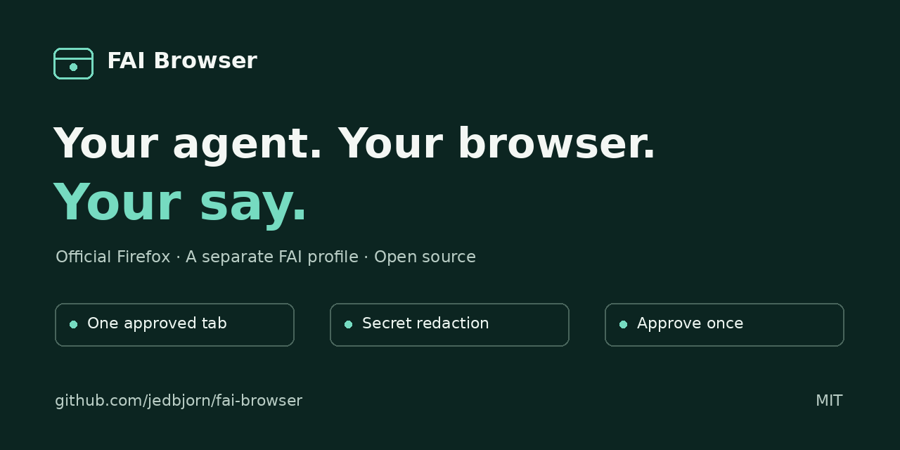
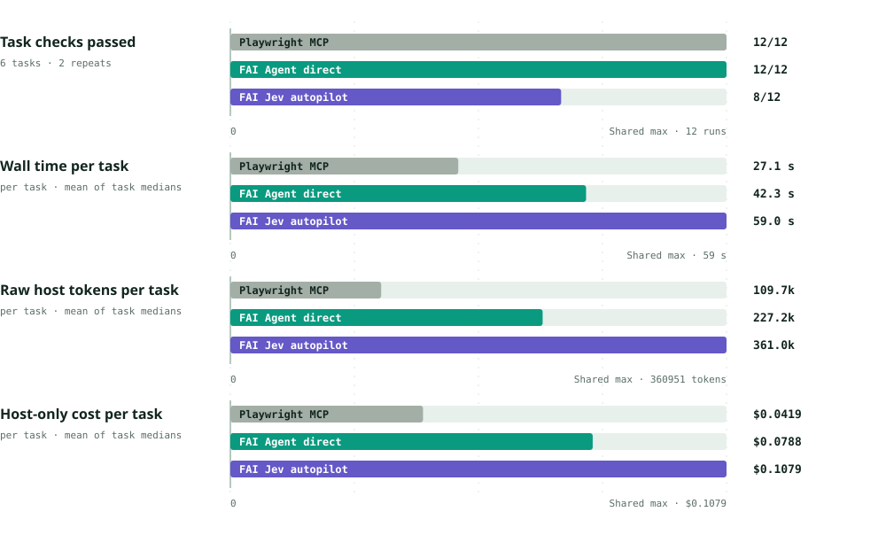
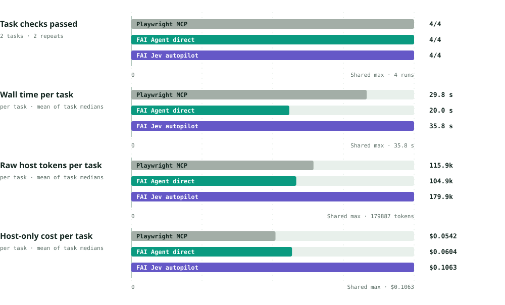
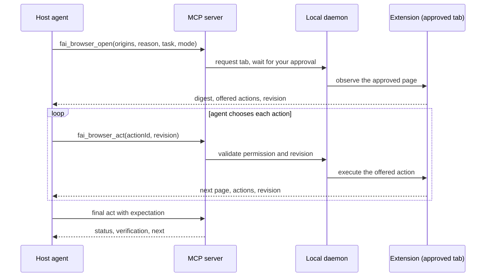

# FAI Browser

**Give your coding agent one browser tab you approve, with compact page summaries,
action approvals and verified outcomes.**

[](https://github.com/jedbjorn/fai-browser/actions/workflows/ci.yml)
[](LICENSE)
[](package.json)
[](package.json)
<br>
[](docs/REFERENCE.md#coding-agents-mcp-and-skill)
[](extension/)
[](#contributing)

[Website](https://jedbjorn.github.io/fai-browser/) · [Install](docs/guide/install.md) · [Measured comparisons](#benchmarks)

FAI Browser lets a coding agent work in one Chrome or Firefox tab you approved, in your own signed-in browser.
By default **your agent drives**: `fai_browser_open` asks for your approval and returns a compact
page digest with the actions your granted level allows; your agent picks one with `fai_browser_act`
and gets the next page back, until an expectation verifies the outcome. No key, no provider calls,
and every action passes the same guardrails: levels, origins, forbidden labels, and explicit
approval for payments. Login is restricted to your configured test environments.

**Experimental: Jev autopilot.** Opt in with `npm run setup -- --driver jev` and a TypeSafe Jev key
to delegate a whole task in one `fai_browser_run`: a fast decision provider picks each step and a
verified receipt comes back. Autopilot benchmarks are reported separately below.

## Why

- **Your agent drives.** Each result contains a compact page digest and allowed actions. The agent
  chooses the next action and checks the outcome against an expectation.
- **Less page text per turn.** On twelve captured public pages replayed locally, opening results
  used a median 1,147 tokens versus 11,787 for full accessibility snapshots (rounded, o200k_base).
  This measures output size, not task success; see the [method and results](bench/tokens/results-real-0.3.1.md).
- **You stay in control.** The agent gets one task tab by default, only after you approve its request: the page opens in
  a new tab in the existing browser window by itself. Click **Approve** in its request modal, allowing browser site
  access when asked, or click the FAI Browser toolbar icon on that tab (a request for `full` or
  `testing` shows the FAI Browser window first, where you pick the level and **Open** the page).
  You can pause or stop at any time. Screenshots on either browser may still need the toolbar click;
  modal approval requests host access, which does not itself grant screenshot access.
- **Results are receipts, not guesses.** `completed` means an independent expectation passed. Each
  result carries a trusted `verdict` and `next {kind, text}`: answer, choose, rerun, relay to the
  user or stop.
- **Invite an agent to a tab you are on.** The toolbar popup's **Invite an agent to this tab** hands the current
  tab to a live Claude Code, Codex or OpenCode session at the level you pick. Approve and Resume wake that session,
  so it continues without you typing "done" (other hosts get a copy-paste line).
- **Several browsers, one service.** The Firefox add-on and Chromium-family builds can be paired at the same time;
  each browser holds its own task tab, and a request opens in the browser you used last (or the one the agent names).
- **Frames you approved are readable.** A cross-origin frame inside the page (an admin portal's content blade, say) is
  read and acted on when its own origin is one you approved; other frames are never read and are boxed in screenshots.
- **Everything is local.** The FAI service, extension and traces stay on your machine, outside the
  checkout; only provider calls leave it.

## Demo

[](https://jedbjorn.github.io/fai-browser/#demo)

[Watch the demo](https://jedbjorn.github.io/fai-browser/#demo) · [Download MP4](docs/media/demo.mp4) · [30-second cut](docs/media/demo-social.mp4)

Real Firefox development-build UI on local test sites, with scripted clicks and edited presentation.
The demo shows payment approval, verified confirmation, secret redaction, and approved secret reuse.
[Capture provenance](docs/guide/demo.md).

## Benchmarks

Three measurements answer different questions: how much page text reaches the agent, how the
default **Agent direct** driver completes a workflow, and how the experimental Jev autopilot
compares across host models. All figures are local fixture runs with their limits stated next
to the numbers.

### Page output size

Twelve captured public pages, replayed locally with 0.3.1. Median opening output with `o200k_base`:

| | FAI Agent direct | Full accessibility snapshot |
|---|---:|---:|
| Observed text tokens | **1,147** | **11,787** |

**90.3% fewer tokens** in the ratio of corpus medians (snapshot median rounded from 11,786.5).
This compares full Playwright-style accessibility snapshots with FAI opening results. It measures
output size, not task success or billed model usage. Current Playwright MCP may return snapshot-file
references; the task benchmark below includes the contents actually read.
[Method, per-page data and limits](bench/tokens/results-real-0.3.1.md).

### Model-driven task comparison

Measured 2026-11-06 on local fixtures, two repeats per task. Values are per-task averages of
per-task medians. Wall time is host spawn to exit. Host tokens are full vendor usage; cost is
host-only pricing from `bench/prices.json`, not a subscription invoice. Bars are labeled directly;
lower time, token and cost bars are better, while higher pass counts are better.

#### Text workflows · Sol 6.1 medium



#### Visual workflows · Claude Sonnet 5.5 medium



| Workflow set | Metric | Playwright MCP | FAI Agent direct | FAI Jev autopilot |
|---|---|---:|---:|---:|
| Sol 6.1, 6 text tasks | Task checks passed | 12/12 | 12/12 | 8/12 |
| | Wall time | 27.1 s | 42.3 s | 59.0 s |
| | Raw host tokens | 109.7k | 227.2k | 361.0k |
| | Host-only cost | $0.0419 | $0.0788 | $0.1079 |
| | Jev provider tokens | — | — | 24.5k |
| Claude Sonnet 5.5, 2 visual tasks | Task checks passed | 4/4 | 4/4 | 4/4 |
| | Wall time | 29.8 s | 20.0 s | 35.8 s |
| | Raw host tokens | 115.9k | 104.9k | 179.9k |
| | Host-only cost | $0.0542 | $0.0604 | $0.1063 |
| | Jev provider tokens | — | — | 31.5k |

Jev provider tokens are additional to raw host tokens and are not included in host-only cost.
Two safety scenarios are excluded from performance figures; all runs had zero safety flags.
Sources: Agent-direct [text](bench/results/site-agentdirect-optimized-2026-11-06/summary.json) and
[visual](bench/results/site-agentdirect-optimized-visual-2026-11-06/summary.json) summaries;
[Jev comparison](bench/results/jev-comparison-2026-11-06.json).

The earlier native-relay pass (`bench/showcase/results-native-2026-11-06.md`) reports the
same four workflows with protocol-level detail (MCP calls, snapshot-file reads, observed
text tokens) plus the two safety scenarios; it makes no speed or cost claim. The separate
live Amazon/eBay search probe returned HTTP 503/403 and claims nothing.
[Probe results](bench/showcase/results-live-search-2026-11-06.json).

## How it works



The daemon on `127.0.0.1:4318` owns tab requests, leases, runs, traces and the provider key; the
extension acts only in the approved tab. See [ARCHITECTURE.md](ARCHITECTURE.md).

## Quickstart

Requires Node 22+ and a Chromium-family browser 116+ (Chrome, Chromium, Brave, Edge, Vivaldi) or Firefox 140+, on
Linux or macOS. See [Browsers](#browsers).

**Try it without a key or browser:**

```sh
npm test
node examples/fake-demo.js   # deterministic provider and in-memory bridge; prints a result
```

**Set it up for real (one time):**

```sh
git clone https://github.com/jedbjorn/fai-browser.git
cd fai-browser
npm ci
npm run setup
```

1. `npm run setup` saves its settings in `~/.config/fai-browser` (macOS: `~/Library/Application
   Support/fai-browser`), installs browser pairing for every browser it finds, starts the FAI service and asks
   whether to register FAI Browser with each coding agent on your `PATH` (Claude Code, Codex, OpenCode).
2. Pick a browser ([install guide](docs/guide/install.md)):
   - **Firefox, dedicated FAI profile (recommended):** accept setup's last prompt, or run `node src/cli.js launch`.
     It starts Mozilla's unmodified Firefox with a separate profile and the signed add-on, already paired.
   - **Your existing Firefox:** install the signed `fai-browser-firefox-<version>.xpi` from
     [GitHub Releases](https://github.com/jedbjorn/fai-browser/releases).
   - **Chromium family, from source:** open `chrome://extensions` (or `brave://`, `edge://`), turn on Developer mode,
     click **Load unpacked** and select `extension/`.

   The extension pairs by itself: nothing to copy or paste.
3. Pin the FAI Browser icon (puzzle-piece menu, then the pin) for controls, invites and toolbar approval. You can
   also approve directly in the request modal.
4. Restart your coding agent.

To try the experimental Jev autopilot, run `npm run setup -- --driver jev` instead: it asks for the Jev key at
a hidden prompt. To register an agent later: `node src/cli.js install --host claude|codex|opencode`.

**Updating.** About once a day FAI checks GitHub for a newer tagged release and the popup then shows **Update
available vX.Y.Z**. One click on **Update** (or `node src/cli.js update`) moves this clone to the release tag, refreshes
pairing and the installed skill, restarts the FAI service and reloads the extension; nothing installs without it.
It refuses while an agent holds a tab and never touches local changes. The signed Firefox add-on updates itself.
See [Updates](docs/REFERENCE.md#updates).

**Invites and wakes.** On any normal web tab, the popup's **Invite an agent to this tab** binds that tab, at the level
you choose, to a live coding-agent session and wakes it with a single-use invite id (`inv-…`, 10 minutes); the agent
calls `fai_browser_open {"inviteId": "inv-…"}`. When FAI can wake the session (Claude Code's messaging socket, Codex's
`codex queue`, OpenCode through the small FAI plugin `install --host opencode` adds), your Approve or Resume click
continues the agent's turn; otherwise the popup shows a line to paste into the chat. See
[Invites and wakes](docs/REFERENCE.md#invites-and-wakes).

With your agent driving, `fai_browser_open` requests approval and returns the first page: digest,
offered actions and a single-use revision. Your agent answers from the digest or calls
`fai_browser_act` with an action id and that revision; each act returns the next page and actions.
A filled search field offers "press Enter"; a deep URL in `allowedUrls` opens directly on approval;
screenshots are on request only. An expectation on the final act verifies the outcome. See
[Your agent driving](docs/REFERENCE.md#agent-direct).

Once a Jev key is saved, the extension's **Advanced** section switches between **Your agent** and
**Jev autopilot (experimental)**; the choice applies on the next agent call, with no terminal
command or agent restart.

**Delegate a task from the shell (experimental Jev autopilot):**

```sh
node src/cli.js run "Open Members" --origin https://app.example.com \
  --reason "Check the members list" --expect-url-includes /members
```

In the extension's **Advanced → Tab access**, **One task tab** is the default; a page-created tab or popup pauses the task. Choose **Multiple task tabs** before approving a request to let the agent open and switch among up to eight task tabs on the approved site. The browser asks for site access, the tabs share the task group where supported, and existing personal tabs stay outside the task. Switching back to one pauses a multiple-tab task. The chosen permission level still applies.

The CLI asks you to approve the request (the page opens in a new task tab; click **Approve** in the request modal
or the toolbar icon on that tab; for `--mode full`, **Open** in the FAI Browser window first), runs the task and
prints one JSON line.

**Or from your agent, through MCP (Jev autopilot):**

```json
{
  "name": "fai_browser_run",
  "arguments": {
    "origins": ["https://app.example.com"],
    "reason": "Check the members list",
    "instruction": "From the home page open Members. Read how many members are listed.",
    "expectation": { "urlIncludes": "/members" },
    "answerQuestion": "How many members are listed?"
  }
}
```

With the Jev autopilot the result has the same shape either way (trimmed):

```json
{
  "v": 2,
  "status": "completed",
  "code": "expectation_passed",
  "verification": { "checked": true, "passed": true, "expectation": { "urlIncludes": "/members" } },
  "page": { "url": "https://app.example.com/members", "title": "Members", "digest": ["..."] },
  "verdict": { "kind": "verified", "oversight": "none", "answer": null, "why": ["expectation_passed"] },
  "next": { "kind": "answer_from_digest", "text": "..." }
}
```

The host follows `next.kind` literally. The MCP server's instructions cover a one-call task on their
own; the [skill](skills/fai-browser/SKILL.md) installed by `install --host` teaches the full loop;
[docs/REFERENCE.md](docs/REFERENCE.md#output-status-and-exit-codes) documents every field, status
and exit code.

## Safety model

- **One tab per request, approved by you.** Each request names exact origins (or, for a task across
  subdomains, a domain root shown to you as "all of example.com", which Chrome also asks you to allow)
  and a reason; the agent cannot select a tab.
- **You pick the level, per tab.** The agent asks for a `mode`; the request card offers that level
  and those below it, preselected to what was asked: **Read** (links, scroll, wait), **Use** (also
  buttons, selects, fills of supplied text, and search, filter, sort and paging submits on pages
  without password or payment fields) or **Act** (also save, send, submit, delete and accept cookies).
  Your choice is a ceiling: the run is clamped to it and the receipt's `permissions` block says what
  ran. Nothing the agent, the page, a `policy` or `config.json` sends can raise it.
- **Payments require your approval.** With the agent driving and the Approve gate enabled,
  a payment action waits for your **Approve once** click. With the gate off or the experimental
  Jev autopilot driving, purchases are refused outside testing mode. Sign-in pages are handed
  back to you; agents may enter credentials only in your configured test environments.
- **Testing mode is for your test environments only.** It permits sign-in and checkout and can
  only be chosen in the popup (**Test site**) for origins you listed under Advanced, Test sites
  (`http://localhost:3000`, exact origins, no wildcards). Secret-handle use still requires approval;
  filling a saved secret handle into password fields on sign-in forms is currently unsupported.
- **Cookie dialogs are rejected first**, at every level; below Act, accept-only dialogs go to you.
- **Guardrails you can tighten at any level.** `policy: {"forbid": [...], "note": "..."}` per run or
  in `config.json` adds refused labels, testing included; nothing removes one.
- **Page text is untrusted.** Receipts separate trusted fields from page text; an injection guard
  limits what runs on pages that address an agent.
- **Local service and traces.** Agent direct makes no FAI provider calls. The optional Jev
  autopilot sends observations to its provider and uses your locally stored Jev key to authenticate
  those requests. Supplied values are redacted before provider requests; traces are pruned
  (50 runs, 500 MB, 7 days). The only other outbound request is the daily update check, an
  anonymous GET to GitHub's releases API (with a `git ls-remote` fallback on your clone's remote if
  the API does not answer for the repository; `FAI_UPDATE_CHECK=0` turns it off).

Details: [Policies and providers](docs/REFERENCE.md#policies-and-providers),
[Guardrails](docs/REFERENCE.md#guardrails) and [Traces and
retention](docs/REFERENCE.md#traces-and-retention).

## Works with

| | |
|---|---|
| **Coding agents** | Claude Code, Codex CLI and OpenCode via `node src/cli.js install --host claude\|codex\|opencode`, with invites and wakes for all three; any other MCP client through the stdio server `fai-browser-mcp` (no wakes) |
| **Without MCP** | the CLI (`node src/cli.js`, one JSON line per command) and the SDK client (`FaiBrowserClient`) |
| **Decision providers** | TypeSafe Jev (default) and local SystemOne-compatible servers; custom providers implement one `decide()` method |
| **Browser** | Chrome, Chromium, Brave, Edge or Vivaldi 116+ (Manifest V3), Firefox 140+ (a signed build of the same extension); several can be paired at once; pairing by native messaging. See [Browsers](#browsers) |

### Browsers

| Browser | Status | Load | Tested |
|---|---|---|---|
| Chrome, Chromium | Supported | `chrome://extensions`, Developer mode, **Load unpacked**, `extension/` | headless Chromium (`npm run browser-smoke`), headed Chrome |
| Brave, Edge, Vivaldi | Supported (Chromium, same extension) | `brave://extensions`, `edge://extensions`, `vivaldi://extensions` | native pairing paths in unit tests |
| Firefox 140+ | Supported, with the gaps below | `node src/cli.js launch` (dedicated profile), or the signed `.xpi` from [Releases](https://github.com/jedbjorn/fai-browser/releases); for development `npm run build:firefox` and **Load Temporary Add-on** from `dist/firefox/` | headless Firefox 159 (`npm run smoke:firefox`), `web-ext lint` |
| Firefox for Android, Safari | Not supported | | |

**Firefox install.** Each release carries a Mozilla-signed add-on (`fai-browser-firefox-<version>.xpi`) that
installs in any Firefox 140+ and updates itself; `node src/cli.js launch` puts it in a dedicated FAI profile of
Mozilla's unmodified Firefox ([install guide](docs/guide/install.md)). A temporary add-on loaded from `dist/firefox/`
is removed when Firefox restarts; for development, `npx web-ext run --source-dir dist/firefox` starts a throwaway
profile with it loaded. Setup installs
the native messaging host for Firefox too (also for Firefox 147+ profiles under `~/.config/mozilla/`), so the add-on
pairs by itself. Snap and Flatpak Firefox cannot start the host: pair by hand (`node src/cli.js pair`, then the
popup's Advanced section).

**Firefox gaps.** Firefox drops `activeTab` at a tab's first navigation, so the approval click also asks Firefox for
the request's exact origins (one Firefox prompt per new site; the add-on removes each grant it caused when the
request ends). Firefox's `captureVisibleTab` needs `activeTab` or all-sites access, so after the first navigation
there is no screenshot unless you turn on **Access your data for all websites** in `about:addons`, FAI Browser,
Permissions (page text, actions and the Approve gate work either way; the add-on never asks for it). Firefox host
permissions take no port: approving `http://127.0.0.1:8080` grants `http://127.0.0.1` on every port. Details in
[REFERENCE: Firefox](docs/REFERENCE.md#firefox).

## Documentation

| Document | What it covers |
|---|---|
| [docs/REFERENCE.md](docs/REFERENCE.md) | Full manual: setup, daemon, environment variables, MCP tools, CLI flags, status table and exit codes, screenshots, traces, SDK, policies, guardrails, limits |
| [ARCHITECTURE.md](ARCHITECTURE.md) | Components, tab requests and leases, MCP server, receipt v2 and the oversight ladder |
| [RESULTS.md](docs/results/RESULTS.md) | Measured before/after across six host models, with method and limits |
| [docs/TESTED.md](docs/TESTED.md) | Every page type, task and live site FAI Browser was tested on, and the actions each mode offers |
| [bench/README.md](bench/README.md) | The agent comparison harness and how to reproduce it |
| [skills/fai-browser/SKILL.md](skills/fai-browser/SKILL.md) | The host-facing guide to the tool loop and `next.kind` |
| [tasks/](tasks/) | Task sub-skills: a host guide per task (`tasks/flights/SKILL.md`, `tasks/hotels/SKILL.md`), installed with the skill, plus reviewed task engine code |
| [AGENTS.md](AGENTS.md) | Rules for agents using FAI Browser in this repository |
| [PROPOSAL.md](docs/design/PROPOSAL.md) | Design, roadmap and every pass to date |
| [OVERSIGHT-SPEC.md](docs/design/OVERSIGHT-SPEC.md) | The oversight and verification specification |
| [docs/PUBLISHING.md](docs/PUBLISHING.md) | Publication hygiene: secret scan and results sanitizing |

## Status and roadmap

FAI Browser is an **early release (v0.6.2)**: the daemon, MCP server, skill, guardrails and benchmark
harness work and are tested, and interfaces may still change. Open items:

- **Extension UX:** a side panel with a pending-request badge, live run view and real pause and
  resume (today, Pause ends the run).
- **Registered domains:** a bootstrapper skill that tests a new site and produces a domain pack
  (host skill text, Jev policy additions, settings), proposed and not yet built.
- **Broader real-site coverage:** additional runs to evaluate compatibility and guardrail thresholds
  beyond the current local fixtures and recorded public-page corpus.

Known limits today: one active tab lease per browser; login, MFA, cross-origin frames you did not approve and
unusual widgets need the user. See [Limits](docs/REFERENCE.md#limits).

## Contributing

Issues and pull requests are welcome. Before you open a PR:

- Run `npm ci && npm test` on Node 22+.
- Keep the safety boundaries intact: the label and field patterns in `src/guardrails.js` (`PURCHASE`,
  `COMMIT_OTHER`, `SUBMIT_WORDS`, `DELETE_WORDS`, `SIGN_IN_WORDS`, `SAFE_SUBMIT`, `PAYMENT_AUTOCOMPLETE`,
  `PAYMENT_FIELD`, `normalizeLabel`, `forbidPattern`) are copied byte for byte into `extension/page.js`,
  and the level table into `extension/background.js` and `extension/permissions.js`; the drift tests
  fail when one side changes alone.
- For changes to the agent loop, measure with the harness in [bench/](bench/README.md), one change
  per run.
- Never commit `.env.local`, `client-token` or raw traces; run `node scripts/secret-scan.mjs` before
  committing bench summaries (see [docs/PUBLISHING.md](docs/PUBLISHING.md)).

## Use at your own risk

- **Website terms.** Automating a website with FAI may break that site's terms of service. You are responsible for
  following the terms of every site you use it on.
- **No warranty.** FAI is provided as-is under the [MIT license](LICENSE). The authors are not responsible for how you
  use it or for what an agent does with it.
- **Your data stays with you.** Settings, the pairing secret, screenshots, traces and task history stay on your machine
  and are never sent to the authors. Keeping that machine and those files secure is up to you; traces and screenshots
  are pruned automatically (50 runs, 500 MB, 7 days by default). Page content does go to your coding agent's model
  provider, and to the Jev provider if you turn the autopilot on.

This is a plain-language summary, not legal advice.

## More projects

Other open-source projects by the same author:

- [subfloor](https://subfloor.designs-os.com): a forkable shell substrate for a code repository, with DB-backed
  identity, memory and roadmap, independent of the agent harness.
- [rst-c (RST)](https://jedbjorn.github.io/rst-c/): a native Revit add-in for curated ribbon profiles that users load
  with one click.
- [gantt-it](https://github.com/jedbjorn/gantt-it): a Revit add-in that draws Gantt charts inside your project, ready
  to place on sheets.
- [splash-it](https://github.com/jedbjorn/splash-it): a Revit add-in that colors view tabs by file, so open models and
  families are easy to tell apart.
- [md-converter](https://md-converter.designs-os.com): turns Markdown into themed, shareable HTML in the browser.
- [storybench](https://github.com/jedbjorn/storybench): a local workspace for developing videos with an AI production
  agent.
- [anj-cloud](https://github.com/jedbjorn/anj-cloud): household file sync from a self-hosted gateway, with clients for
  Linux, macOS, Windows and Android.

## License

[MIT](LICENSE) © 2026 FAI Browser contributors.

